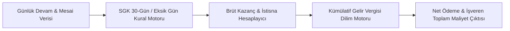

# Açık Erişim İK Puantaj ve Bordro Hesaplama Mimarisi

> İK yöneticileri, mali müşavirler ve uygulayıcılar için oturum açmadan doğrudan tarayıcı üzerinde çalışan **Aylık Puantaj Cetveli** ve **Brüt ↔ Net Maaş / İşveren Maliyeti Simülatörü** mimari özeti.

## 1. Canlı Araçlar (Ücretsiz & Açık Erişim)
1. **[Aylık Puantaj & Eksik Gün Hesaplama Cetveli](https://generalist.tr/hesaplama/puantaj.php)**
   - 30 gün / parmak hesabı (28-29-30-31 gün çeken aylar) SGK gün kuralı uyumu
   - Hafta tatili, genel tatil, ücretsiz izin, rapor ve fazla mesai saatlerinin anlık hesaplanması
   - Yazdırılabilir resmi puantaj cetveli çıktısı
2. **[Brüt ↔ Net Bordro & İşveren Maliyeti Simülatörü](https://generalist.tr/hesaplama/bordro.php)**
   - 12 aylık kümülatif gelir vergisi matrahı ve dilim geçişlerinin otomatik takibi
   - Asgari ücret gelir ve damga vergisi istisnası hesaplaması
   - 5510 sayılı kanun 5 puanlık hazine teşviki dahil/hariç toplam işveren maliyeti analizi
   - Netten brüte (iteratif yakınsama motoru) ve brütten nete çift yönlü hesaplama

## 2. Hesaplama Motoru Akışı

## 3. Erişim Bağlantıları
- **Bordro Simülatörü:** [https://generalist.tr/hesaplama/bordro.php](https://generalist.tr/hesaplama/bordro.php)
- **Puantaj Cetveli:** [https://generalist.tr/hesaplama/puantaj.php](https://generalist.tr/hesaplama/puantaj.php)
- **Kişisel Karargâh:** [https://generalist.tr](https://generalist.tr)
